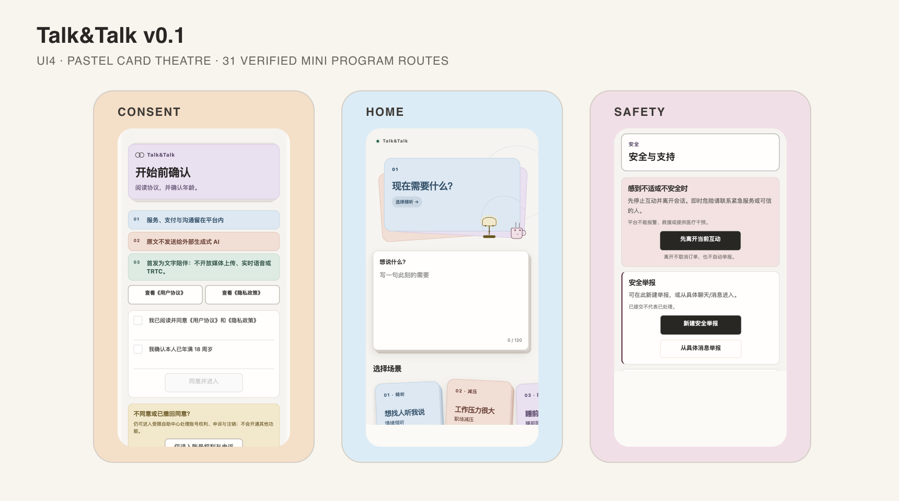
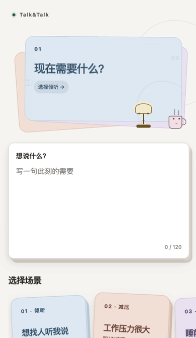

# Talk&Talk v1.0

Talk&Talk 是一款微信小程序优先的线上文字陪伴产品。v1.0 包含可上传的原生小程序、NestJS API、公开 Web、运营后台与独立审核台，并统一使用浅彩卡牌剧场界面。

正式小程序源目录是 `frontend/miniprogram`；`main` 是 v1.0 的发行分支。



[v1.0 发布说明](./docs/releases/v1.0.md) · [UI4 设计系统](./frontend/miniprogram/UI4_DESIGN_SYSTEM.md) · [历史 v0.1 验收](./docs/2026-09-01-ui4-final-validation.md)

## 产品方向

v1.0 的核心是浅色、低饱和、多元卡牌：用叠卡制造空间感，用克制动效完成反馈，用更少文字保留当前事实和下一步动作。首发聚焦文字陪伴；发现、广场、预约、支付、订单消息、售后、账号权利与陪伴者工作台构成完整业务界面。



[播放 MP4](./artifacts/v0.1/talktalk-v0.1-motion-demo.mp4) · [查看小程序截图](./artifacts/v0.1/screens/README.md) · [媒体清单](./artifacts/v0.1/manifest.json)

## 发行范围

| 表面 | v1.0 范围 |
| --- | --- |
| 微信小程序 | 31 个用户与陪伴者页面，18 个共享组件 |
| 公开 Web | `/`、`/how-it-works`、`/safety`、`/about`、`/partners` |
| API | NestJS `/api/v1`，PostgreSQL 与 Redis |
| Admin | 商业运营后台 |
| Independent Review | 独立审核台与独立身份域 |

## 仓库结构

```text
frontend/miniprogram/  微信小程序正式源
frontend/web/          公开 Web 路由
backend/api/           API、Admin、Review 与法律页
shared/contracts/      OpenAPI v1 契约
infra/                 本地与部署参考
docs/                  发布说明、验收与运行手册
artifacts/v0.1/        历史 UI 参考与评审材料，不是正式上传目录
```

## 快速开始

需要 Node.js 22+、PostgreSQL、Redis 和微信开发者工具。

合伙人联调或微信上传时，直接在微信开发者工具导入正式目录：

```bash
frontend/miniprogram
```

选择 Talk&Talk 的真实小程序 AppID 后即可编译、预览与上传。正式目录启用合法域名校验，并按开发版、体验版、正式版连接对应后端。

本机开发才使用下面的 API 与隔离副本流程。

```bash
cd backend/api
npm install
cp .env.example .env
npm run prisma:migrate
npm run start:dev
```

```bash
npm --prefix frontend/miniprogram install
node frontend/miniprogram/scripts/create-local-copy.mjs \
  --api-base-url http://127.0.0.1:3000/api/v1
```

在微信开发者工具中导入 `frontend/miniprogram-local` 做本地联调。不要把正式源 `frontend/miniprogram` 当作免后端演示工程；可上传的正式源仍只有 `frontend/miniprogram`。

```bash
cd frontend/web
npm install
npm run dev
```

## 验证

```bash
# Mini Program
backend/api/node_modules/.bin/tsc -p frontend/miniprogram/tsconfig.json --noEmit
node frontend/miniprogram/scripts/validate.mjs
node frontend/miniprogram/scripts/smoke.mjs
node frontend/miniprogram/scripts/ui2-audit.mjs
node frontend/miniprogram/scripts/ui3-contrast-audit.mjs
node frontend/miniprogram/scripts/ui4-copy-audit.mjs

# Public Web
npm --prefix frontend/web run check

# API / Admin / Review static gate
npm --prefix backend/api run build
npm --prefix backend/api run test:preflight:static
npm --prefix backend/api run verify:prod-artifacts
```

v1.0 的代码范围、版本号、测试结果与外部发布回执统一记录在 [发布说明](./docs/releases/v1.0.md)。历史截图评审工程不会进入正式微信上传包或 v1.0 Release 资产。

更多入口：[项目指南](./docs/GUIDE.md) · [小程序开发](./frontend/miniprogram/README.md) · [部署与回滚](./docs/deploy-rollback.md) · [下一阶段](./NEXT_PHASE.md)
